# AndroidOptimisationTask - Task 3
# Name: Zuzanna Pawelczyk
# ID: 2506784

## General Idea

My general concept was to create a level where the player is required to explore around with platformer elements to find and destroy barrels. The barrels would be scattered around the stage, with some barrels being easy to access on the ground to allow the player to get accustomed to how they look and what to look for. Then some barrels are placed higher up in the level requiring the player to get a hang of platforming up to the higher levels and even climbing onto the houses to find them, with the grand final barrel being up a mountain the player must platform up. 

## Production

I wanted the player to play an attacking animation and with that destroy the barrel. At first I did this by by doing my extensive and rather complicated method of spawning a line trace every second between the sockets of the sword  during the duration of the attack animation, only to learn that there is a simpler method of tracking what the player hits by attacking a collision box to one of the sword sockets and sizing it around the sword. Once the sword collides with the barrel the barrel deletes itself from existance. 

However, I then decided that the barrel disapearing all of sudden was uninteresting and I wanted it to break into pieces before fading away and with that I had to learn how to use the fracture mode in Unreal, I used this video as help:

Unreal Engine 5 Tutorial - Breakable Jug Part 1: Fractures - YouTube (s.d.) At: https://www.youtube.com/watch?v=uOTZTpl2BFQ&list=PLAb6tdiMqTow&index=9 (Accessed  22/10/2026).

With having changed the barrel to be destroyed into pieces on force instead upon just simple collision I had to rework the way the collision is handled again by instead creating an Anim Notif that gets triggered during the animation and spawns in FSImpact which is a Master Field that creates force within its sphere that then causes the barrel to break apart. 
The video I used as guidance:

Unreal Engine 5 Tutorial - Breakable Jug Part 3: Master Fields - YouTube (s.d.) At: https://www.youtube.com/watch?v=aDc8_Hv_Rgk (Accessed  22/10/2026).

Here's an example of how it works ingame:

I had to learn how to use the landscape mode in Unreal to create a simple landscape with various ground heights so that I could create a simple level for the player to traverse around and have to platform up to get to higher ground. Heres videos I used a basic guidance on how to do that (I explored the brushes and painting and how to use the FAB materials all on my own):

How I quickly make Landscapes in Unreal Engine - YouTube (s.d.) At: https://www.youtube.com/watch?v=BK02nAPuF2c (Accessed  22/10/2026).

With having a map and placing down the barrels I had noticed that it's rather tough for the player to observe where the barrel is amongst other things in the world so I decided to add sparkles within the Barrel's blueprint by using a guide to create a material of a star on transparent background and then put it into a niagara system so it animates the stars to be moving in a cube vacuum around the barrel. I also afterwards made it so that when the barrel gets destroyed in its blueprint it turns off the sparkles. Heres the video I used:

UE5 l Sparkling Particle l Niagara VFX Tutorial l Unreal Engine 5 - YouTube (s.d.) At: https://www.youtube.com/watch?v=pLTqtM-D0ZU&list=PLAb6tdiMqTow&index=11 (Accessed  22/10/2026).

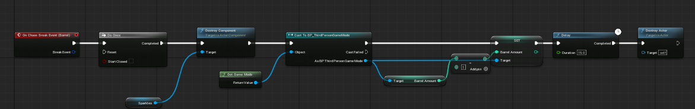

To add in platformer elements into the game I recreated things I made in previous games I made, like the wall jumping and disapearing platforms. With  Wall Jumping you create a unique collision trace channel, and then in the player have a line trace whenever they jump checking if they are against an object that has Wall Jump Trace channel blocked (so it reacts to it) and then launches the player up in the sky by a certain amount of velocity. 

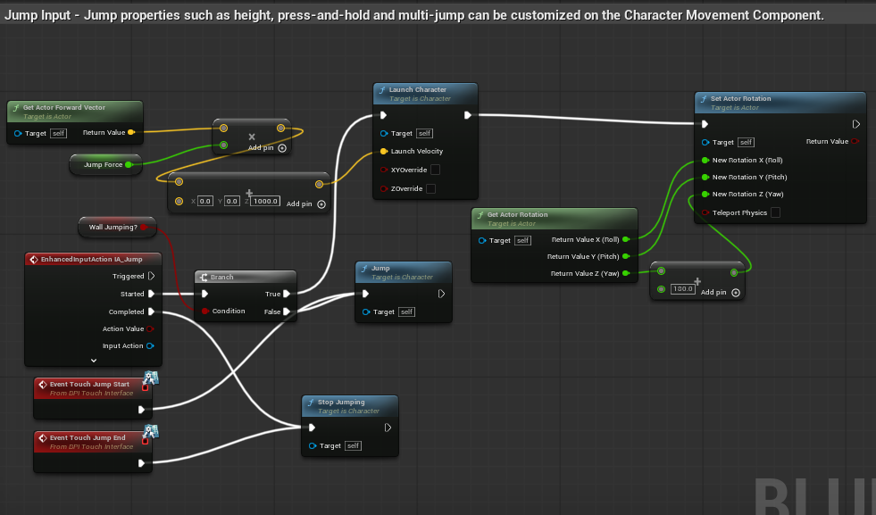
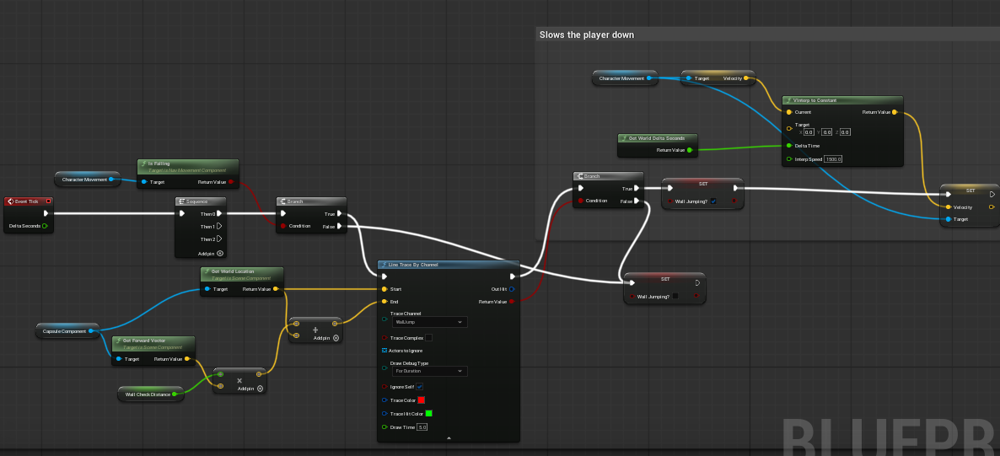

There's an unused material that I wanted to assign to the barrels to make them have an outline, with the guide of a video, however this didn't work on custom meshes even with changing settings within the mesh. The video that didn't work:

How To Hightlight Any Object With An Outline Unreal Engine 5 Tutorial - YouTube (s.d.) At: https://www.youtube.com/watch?v=4-a8QZIf1Dc&list=PLAb6tdiMqTow&index=12 (Accessed  22/10/2026).

With disapearing platforms you just add a static mesh of a cube and then assign it a collision box that only surrounds the very top of the mesh avoiding the sides or corners as to not trigger unfairly, and then when the player walks into the collision box, the static mesh disapears and looses its collision. I do not destroy the object as afterwards, after a delay I can choose to bring the static mesh back so if the player fails at first they can retry with the platform reapearing. 

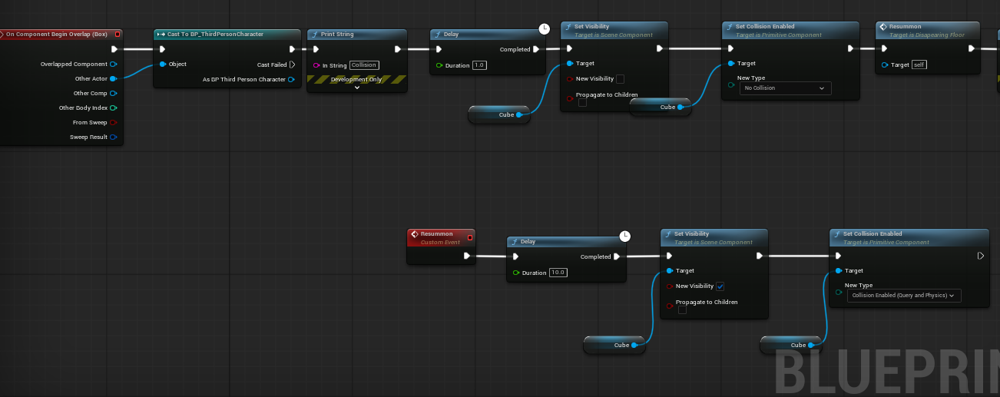

I added a bunch of menu's that scale responsibly with the screen size by all the elements being placed in scale boxes and then anchored to the specific part of the screen I want them to remain in no matter what. Which includes a lil UI on screen that displays how many barrels are left in game, which gets updated every time a barrel is destroyed. 

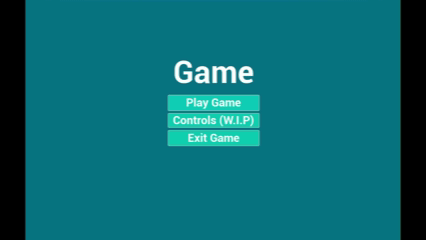

I added a Start menu that updates to being a Pause menu once the player clicks play, as well as an End screen menu. The Start menu calls if it "play game" has been clicked before, if it has it changes the text to "continue" and changes the opacity of the background to be lower so you can see through it to the game in the pause menu.

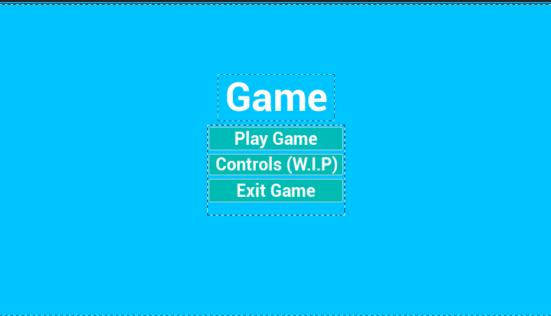

With adding menu's I added a "cutscene" at the start of the game to explain to the player what to do, all it does is have the player possess a camera placed in the stage thats deliberately placed to face the NPC, and it displays UI of text with the inspiration of a visual novel where the player can click a button on screen to go through the dialogue and start the game where it then possess the player model and controller. 

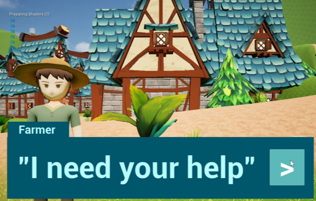

## Mobile Controls and Differences:

While trying to explore how to translate the controls into mobile/touch screen controls I discovered that there's a setting in project settings that allows me to add mobile controls directly into the game that scale approprately with the screen size. In this menu you can choose to change the display of what the buttons/thumbpads look like, where they are relative to the screen, their size, if you want them to move, if you want them to function as a button and to what input it's mapped to. 

With a phone screen you need to alter for all the touch inputs to scale correctly and avoid spots where the players cant reach comfortably on a phone or in a spot where they can't touch. On mobile having so many items loaded on screen at the same time with drop in frames, as well as heat up the phone, therefore I added culling so that only things that are in the players nearest view load in but it captures the level enough so that they dont experience any noticable pop in. I also made sure to find low poly models and nothing with too many polygons or textures that would slow down performance. With a mobile game, you have to expect people to play less due to only playing as a pass time, or the phone heating up over time therefore my next plan when adding levels is to add a save/load feature so that the player can pause the game and get off whenever they want. 

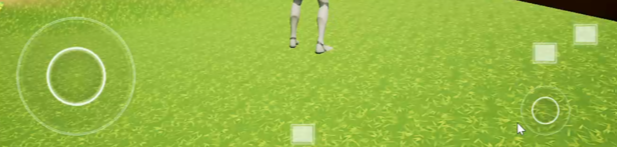
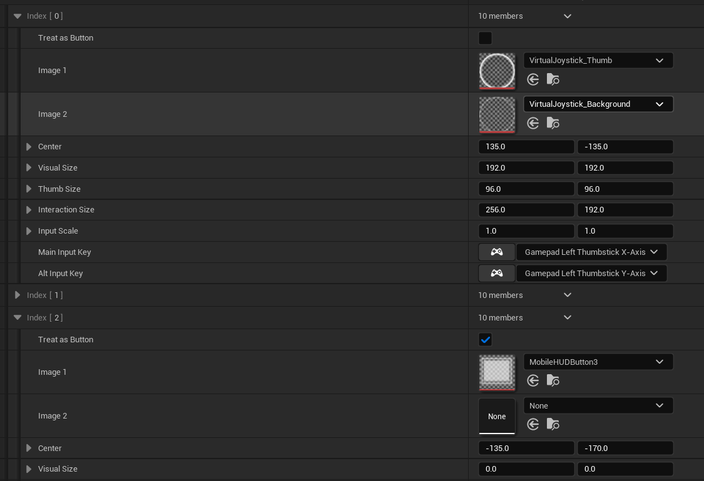

## Resources

All the models for the scenery like the houses, the land materials, barrels, and decoration come from FANTASTIC - Village Pack by Tidal Flask Studios on FAB. 
https://fab.com/s/010701ba1e37
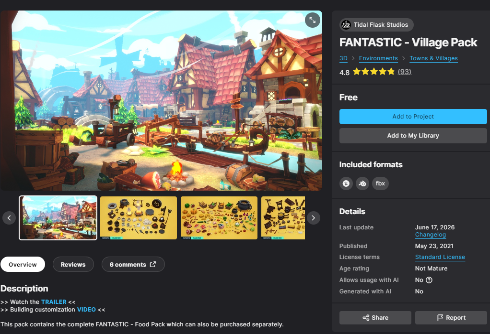

The model for the sword swung by the player came from Sword Quixel Megascans on FAB. 
https://fab.com/s/e27722081ab5
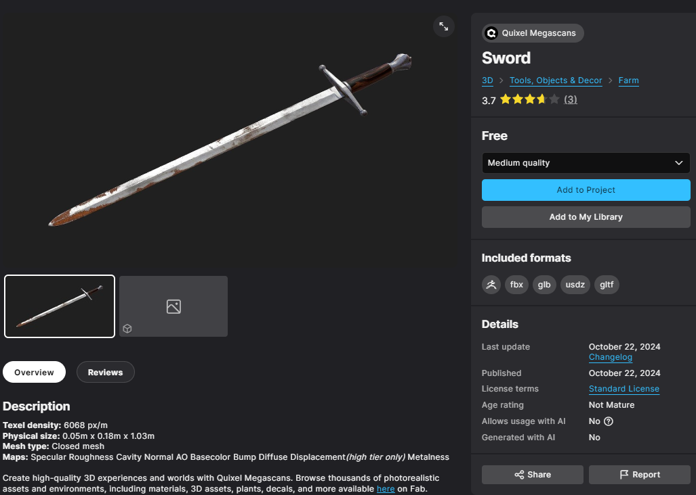

The model for the NPC is from Stylized NPC - Peasant Nolant (DEMO) by Winged Boots Studio on FAB. 
https://fab.com/s/f30cad5e0011
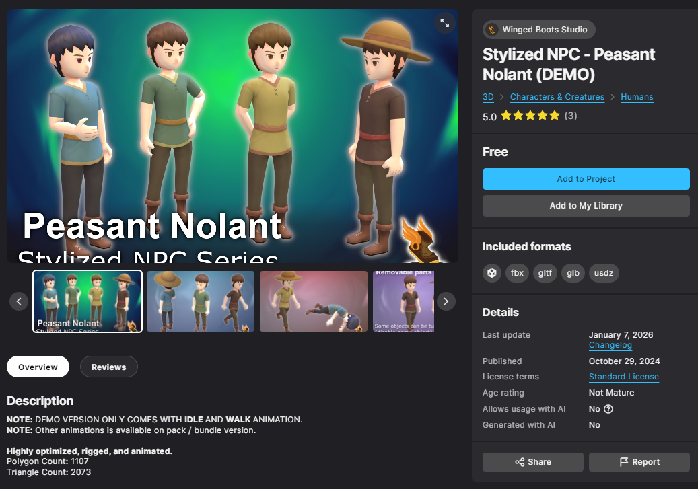

Attacking animation used by the player is from Mixamo. (Sword Slash) 
https://www.mixamo.com/