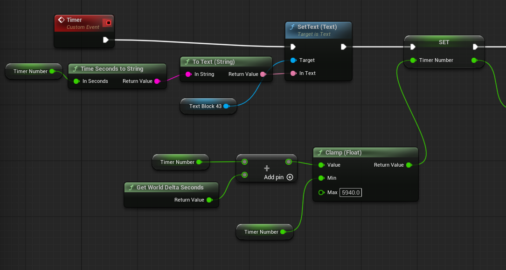
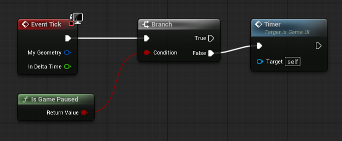
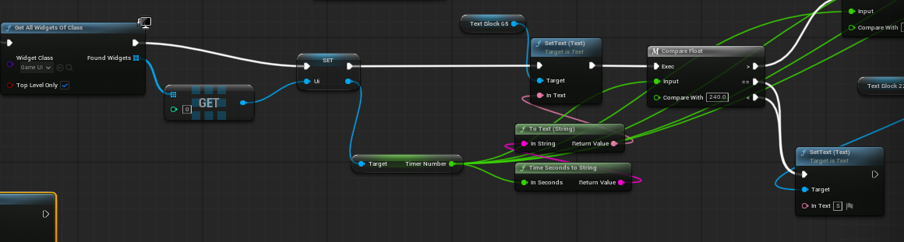
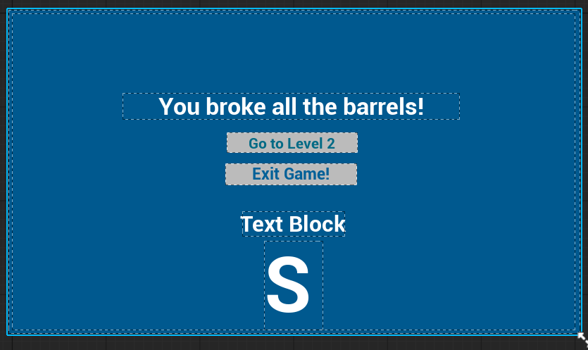
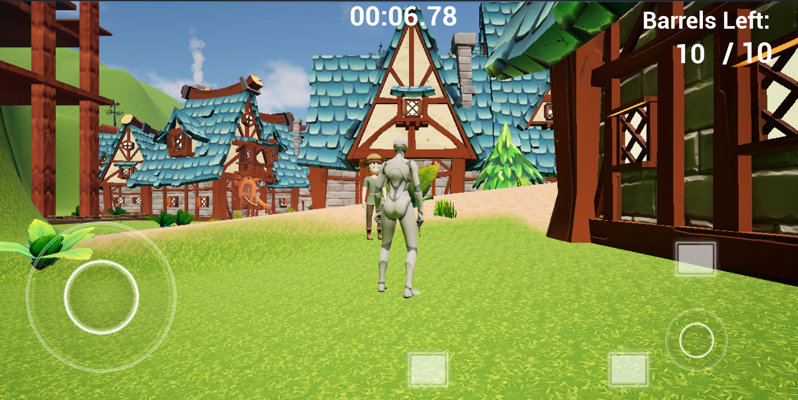
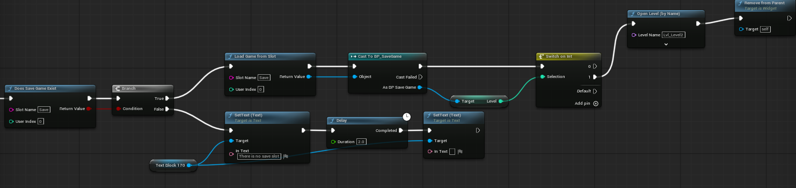
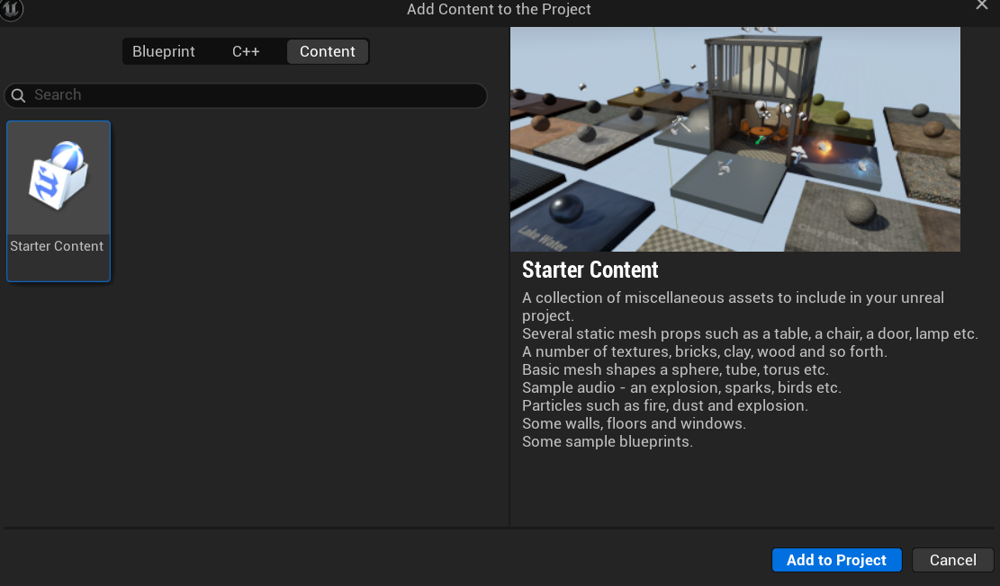

# IOSOptimisationTask - Task 4
# Name: Zuzanna Pawelczyk
# ID: 2506784
## To see the Write Up for Task 3 open Main instead

## General Idea

I built out a second level with the similar assets as the first level sculpting out a new landscape with folliage and I added a river to split up the landscape. For the previous level (and subsequent level) I added a stopwatch timer that counts how long the player took in the level and then compares it and displays a grade depending on how fast they beat the stage. As well as added save and load function to save when the player beats the first stage and moves onto the second, and allows them to load the second stage, this also is adaptable to more stages added in the future.

## The Timer/Score

I had previously made a countdown for a game before so I simply used my old code and reverse engineered it to add time instead of subtract time, and clamp it to the float of 99 minutes so the timer cant go past 99 minutes. It displays in the ui and it gets called every tick, on the condition that the game hasn't been paused. (turning on the pause menu or finishing a level)

In the End Screen upon being created it calls the timer number and displays it on screen and then compares it with other numbers to check how long the player has took to display what grade the player will recieve. 

## Saving/Loading

Upon starting the game it displays a Startmenu where the player can choose to Load Game, if the player has beaten the first stage, it will automatically create a safe file and saves the fact that the player finished level 1, then on start menu if they click "Load Game" it will allow the player to start from Level 2. If there is no save slot the menu will tell the player that the save slot is empty. The player can also choose to delete the save slot where it will ask the player if they are sure before on the second click allowing the player to delete the save slot. 

## Mobile Controls for IOS

I adjusted the size and where the buttons are to where the IOS safe areas are and to avoid notches like accidently closing the game. I made the buttons bigger so they are easier to use and moved them away from the edge of the screen.

Here's the video I used on guidance:

How to Save and Load your Game In Unreal Engine 5 (Easy) - YouTube (s.d.) At: https://www.youtube.com/watch?v=14wmGdbhLOA&list=PLAb6tdiMqTow&index=29 (Accessed  26/10/2026).

Example of how it looks in my game:

## Resources

I used the water ripples texture from the Unreal Starter Content, and added the StarterContent Unreal Engine folder from 5.6.

All the models for the scenery like the houses, the land materials, barrels, and decoration come from FANTASTIC - Village Pack by Tidal Flask Studios on FAB. 
https://fab.com/s/010701ba1e37

The model for the sword swung by the player came from Sword Quixel Megascans on FAB. 
https://fab.com/s/e27722081ab5

The model for the NPC is from Stylized NPC - Peasant Nolant (DEMO) by Winged Boots Studio on FAB. 
https://fab.com/s/f30cad5e0011

Attacking animation used by the player is from Mixamo. (Sword Slash) 
https://www.mixamo.com/